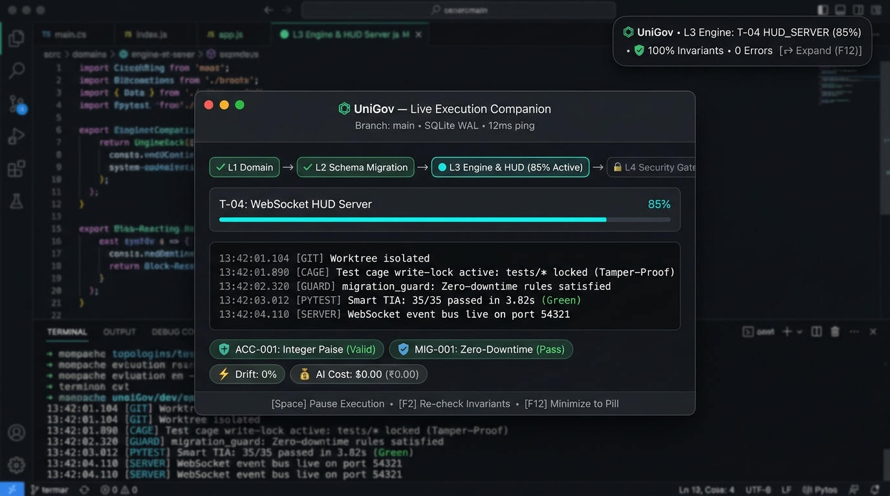
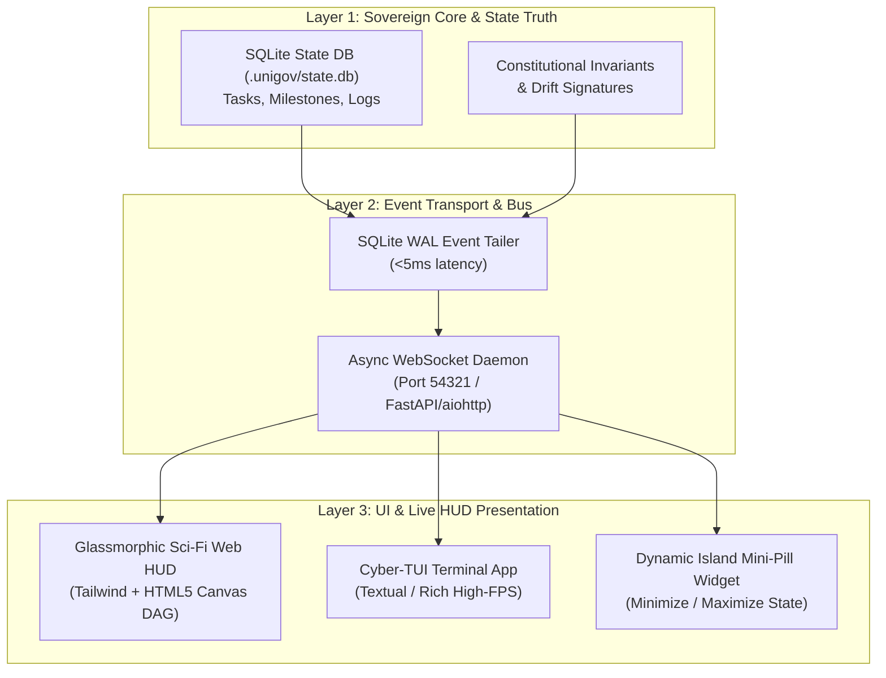

# 🛰️ UniGov v0.9.0: Sovereign Live HUD & Popup Window Upgrade Plan

## Executive Summary
This specification defines the architecture, components, and execution milestones for **UniGov Sovereign HUD** — a realistic, developer-first, mission-control popup window inspired by the design philosophies of Apple (macOS / Xcode / Raycast / Dynamic Island) and Google (Material 3 / Chrome DevTools / Google Cloud Workflows), integrating natively with any CLI or terminal environment.

### 🖼️ UI/UX Visual Mockup (Floating Execution Companion HUD)

---

## 1. Architectural Layers & 5-Layer WBS Breakdown

---

## 2. Milestone Breakdown & Deliverables

### Milestone 1: Event Bus & WebSocket Daemon Core
* **Task ID**: `M5-HUD-01`
* **Module**: `src/unigov/hud/server.py`
* **Responsibility**:
  - Run an ultra-lightweight async WebSocket and static HTTP server on port `54321`.
  - Continuously tail SQLite WAL transactions (`state.db`) and stream delta events:
    - Task state transitions (`READY` ➔ `IN_PROGRESS` ➔ `COMPLETED` / `FAILED`)
    - Audit log streams (`audit_logs`)
    - Invariant tripwire triggers (`constitutional_invariants`)
    - Token/API spend telemetry (`api_usage_logs`)
* **Verification Command**:
  `pytest tests/test_hud_server.py`

---

### Milestone 2: Cyberpunk Glassmorphic Web HUD (Zero-Node Modules)
* **Task ID**: `M5-HUD-02`
* **Module**: `src/unigov/hud/web/index.html`
* **Responsibility**:
  - Single-file, dependency-free frontend with CDN Tailwind CSS & Lucide icons.
  - **Dynamic Island / Mini-Pill mode**:
    - Floating compact widget displaying live task progress bar, health shield %, and token cost.
    - Clickable maximize/minimize toggles (`[—]`, `[□]`, `[✕]`) persisted in `localStorage`.
  - **Interactive Canvas DAG Flow**:
    - Renders topological nodes with glowing vector pulses for active tasks.
  - **Live Monospace Audit Terminal**:
    - Auto-scrolling terminal window with syntax-highlighted status flags (`[PASS]`, `[TRIP]`, `[LOCK]`).
* **Verification Command**:
  `python3 -m unittest -v tests.test_hud_web`

---

### Milestone 3: High-FPS Cyber-TUI (Headless & Terminal Native)
* **Task ID**: `M5-HUD-03`
* **Module**: `src/unigov/hud/tui.py`
* **Responsibility**:
  - Full-featured Textual terminal application styled in deep cyberpunk high-contrast colors.
  - Hotkeys:
    - `F12`: Toggle between Mini-Pill Bar and Full HUD.
    - `r`: Force instant DB sync.
    - `q`: Exit HUD.
  - Works out-of-the-box in Google Cloud Shell, tmux, SSH, and bare terminals without an X11 server.
* **Verification Command**:
  `pytest tests/test_tui.py`

---

### Milestone 4: Universal CLI & Shell Integration Hook
* **Task ID**: `M5-HUD-04`
* **Module**: `src/unigov/hud/launcher.py` & `src/unigov/cli.py`
* **Responsibility**:
  - Wire CLI commands:
    - `unigov hud`: Launches the background daemon, detects environment, auto-opens browser or outputs Cloud Shell Web Preview URL.
    - `unigov hud --tui`: Launches the native terminal Cyber-TUI.
    - `unigov hud --daemon`: Runs the WebSocket server in background.
  - Optional shell prompt integration (`unigov hook bash` / `unigov hook zsh`) for one-line live status bar.
* **Verification Command**:
  `unigov hud --help`

---

### Milestone 5: End-to-End Hardening & Regression Test Suite
* **Task ID**: `M5-HUD-05`
* **Responsibility**:
  - Verify zero-regression against all 35 existing unit tests.
  - Validate WebSocket reconnection resilience (heartbeat/ping-pong).
  - Benchmark resource consumption (<1% CPU idle, <30MB RAM).
* **Verification Command**:
  `pytest -v tests/`
