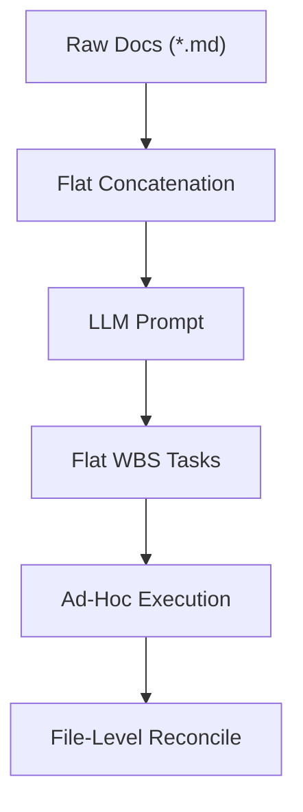
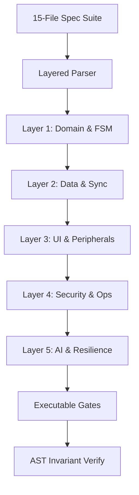

# ⚖️ Deep Architectural Comparison: Current State vs. 15-Dimension Executable Architecture Plan

---

## 📌 Executive Summary

| Dimension | Current State (UniGov v0.4.0) | Proposed Plan (UniGov v0.5.0) | Verdict |
| :--- | :--- | :--- | :--- |
| **Architectural Model** | Flat, Unstructured WBS Extraction | 5-Layer Topological Phase-Locked Architecture | **Massive Leap** |
| **Documentation Type** | Passive Markdown Text (Decays over time) | Machine-Executable Invariant Contracts | **Zero Drift** |
| **Dependency Rails** | Unrestricted DAG (UI can precede Schema) | Strict Topological Order (Layer 1/2 gate Layer 3) | **Eliminates Churn** |
| **Dimension Coverage** | 4 Basic Dimensions (Feature / UI / DB / Logic) | 15 Production Dimensions (Edge AI, FSM, Keystore, Chaos) | **Comprehensive** |
| **Reality Reconciliation** | File & Keyword Symbol Matching | AST Invariant Verification & SLA Proof | **Mathematically Sound** |
| **Disaster Resilience** | None (Relies on external backups) | 60-Second P2P Hardware Swap & Auto-Quarantine | **Production Grade** |

---

## 🔬 1. Head-to-Head Technical Comparison

| Technical Aspect | Current State (v0.4.0) | Proposed 15-Dimension Plan (v0.5.0) |
| :--- | :--- | :--- |
| **Documentation Ingestion** | Concatenates all `.md` files into a single text prompt for the LLM. | Recognizes 15 standardized files across 5 distinct architectural layers with dimensional parsers. |
| **Task Sequencing** | The LLM decides dependencies arbitrarily. UI tasks often become `READY` before DB schemas exist. | Enforces strict Layered Gating: Domain/FSM (L1) and Data/Sync (L2) must be `COMPLETED` before UI/Hardware (L3) unlocks. |
| **Constraint Enforcement** | Strings stored in SQLite (`hard_constraints_json`). Reviewed manually or superficially. | Typed `@Invariant` blocks embedded directly in markdown. Compiles into automated test suites and pre-commit build blocks. |
| **Edge-Case & State Management** | Assumes the "Happy Path". State transitions are implicit. | Mandates explicit Finite State Machines (`02_DOMAIN_RULES_AND_FSM.md`) and illegal transition rejections. |
| **Offline & Concurrency** | Mentions Room transactions, but ignores deduplication on network retry. | Enforces Idempotency Keys, conflict resolution matrices (LWW vs Event Log), and WorkManager battery backoff. |
| **UI State Completeness** | Checks if UI composable/component exists. | Enforces the **5 Mandatory Screen States**: Skeleton Loading, Empty, Error with Retry, Offline Banner, Populated. |
| **Hardware & Peripherals** | Basic code search. | Dedicated ESC/POS thermal printer byte protocol, CameraX scan budgets, and OS permission fallbacks. |
| **On-Device AI (SLM)** | No resource boundaries or memory limits. | Strict RAM budgets ($\le 350\text{ MB}$), latency ceilings ($< 400\text{ ms}$), and low-battery fallback rules. |
| **Audit & Anti-Fraud** | Basic standard database operations. | Cryptographic hash-chained tamper-proof ledger. Prevents backdated deletions or unauthorized edits. |
| **Disaster Survivability** | Process crash leads to manual investigation. | 60-Second P2P encrypted standby sync, DB migration auto-rollback, and transaction quarantine. |

---

## 🔄 2. Execution Pipeline Flow

### Current Linear Flow (v0.4.0)


### Proposed Topological Flow (v0.5.0)


---

## 💥 3. Real-World Failure Scenarios: Today vs. Tomorrow

### Scenario A: The UI-Before-Schema Disaster
- **Current State (v0.4.0)**: UniGov marks `M2-UI-01-01 (Build Searchable Catalog Modal)` as `READY` on Day 1. The developer builds a beautiful UI with dropdown states. On Day 4, when writing `AddStockTransactionDao.kt`, the developer realizes the table structure needs a nested foreign key for distributor brands. **Result**: The entire UI and ViewModel must be refactored from scratch. 3 days wasted.
- **Proposed Plan (v0.5.0)**: UniGov locks `M2-UI` in `BLOCKED` status. The UI task cannot unlock until `04_DATA_SCHEMA` and `02_DOMAIN_RULES` pass AST compilation and migration tests. **Result**: Zero rework. UI is built against stable, verified schemas.

### Scenario B: Offline Double-Tap Duplicate Bill
- **Current State (v0.4.0)**: The shop internet fluctuates. The cashier taps "Complete Sale" twice. The background sync worker retries twice. Two invoices with different IDs are committed to the cloud. Customer ledger and stock counts become permanently desynchronized.
- **Proposed Plan (v0.5.0)**: `05_OFFLINE_SYNC_AND_IDEMPOTENCY.md` enforces that every transaction must generate a client-side UUID `idempotency_key` stored in the Room entity. The second network request hits a unique constraint and safely resolves as a duplicate acknowledgment without inserting duplicate records.

### Scenario C: Counter Crash & Database Corruption
- **Current State (v0.4.0)**: At 8:00 PM during rush hour, the Android device runs out of storage or battery cuts power mid-write. The Room DB becomes corrupted or enters a crash-loop on startup. The cashier has to clear app storage, losing all offline invoices.
- **Proposed Plan (v0.5.0)**: `15_SELF_HEALING_AND_RESILIENCE.md` intercepts the startup failure, auto-reverts to the hourly encrypted checkpoint, quarantines the corrupted byte block into a crash-dump queue, and restarts the app in Safe Mode within 10 seconds. Billing continues seamlessly.

---

## 🛠️ 4. Phased Implementation Roadmap

```
Phase 1: 15-File Taxonomy & Scaffolder (v0.5.0)
  ├── Add `unigov scaffold-docs` with all 15 industry templates
  └── Classify docs into 5 Architectural Layers

Phase 2: Topological Gating & Invariant Engine (v0.5.1)
  ├── Implement Constitutional Layer Locks (L1 & L2 gate L3)
  └── Parse `@Invariant` JSON/YAML blocks from markdown

Phase 3: AST Deep Audit & Reality Convergence (v0.5.2)
  ├── Audit 5-State UI coverage (Loading, Empty, Error, Offline, Populated)
  ├── Audit Law ACC-001 integer paise and Room idempotency columns
  └── Merkle hash-chain verifier for audit ledger

Phase 4: Disaster Recovery & Chaos Resilience (v0.6.0)
  ├── P2P local encrypted micro-sync protocol
  └── Safe-Mode auto-recovery harness
```

---

## 🎯 Strategic Recommendation

We should adopt the **15-Dimension Executable Architecture Plan** as the sovereign foundation of UniGov. By transforming static documentation into executable machine invariants, UniGov evolves from a basic task tracker into an authoritative, autonomous software architect that prevents regressions before a single line of application code is merged.
