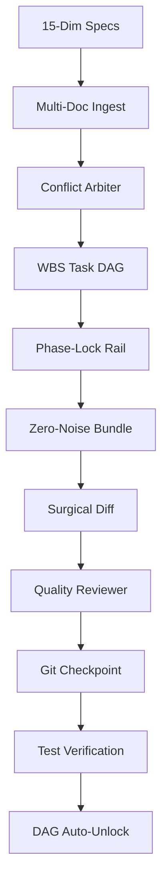

# 🏛️ UniGov

> **Sovereign Autonomous Project Governance Engine & Deterministic State Machine for AI-Native & Multi-Repo Software Ecosystems.**  
> *Eliminate Context Drift. Halt Hallucinated Completions. Enforce Architectural Ground Truth.*

[](https://www.python.org/)
[](LICENSE)
[]()
[]()
[]()
[]()

---

## ⚡ The Fundamental Crisis in AI Software Engineering

When developing complex multi-module software systems, the bottleneck is rarely syntax generation. Generative models easily output code. The catastrophic engineering failures occur at the governance layer:

1. **Context Drift:** Beyond 30k–50k tokens, language models lose fidelity over architectural constraints, database transaction boundaries, and state machines.
2. **Hallucinated "Completions":** Autonomous AI agents proclaim features "completed" without executing compilers, verifying schemas, or running test suites.
3. **Catastrophic File Overwrites:** Whole-file rewriting destroys working edge-case logic, concurrency guards, and production comments.
4. **Multi-Repo Contract Desync:** Mutating a database schema or API contract in an upstream repository silently breaks dependent consumer applications.

---

## 🛡️ The UniGov Architecture: Decoupling Reasoning from State

**UniGov** resolves this by strictly decoupling **Probabilistic Reasoning** from **Deterministic State**:

- **Reasoning (AI Compute):** LLMs (Google Gemini 3.1/3.5 or local Ollama Qwen-Coder) are restricted to stateless analysis, AST classification, and surgical search/replace diff generation.
- **Ground Truth (Deterministic Spine):** An ACID-compliant, local **SQLite WAL State Machine (`.unigov/state.db`) + Git Checkpoints** hold unalterable ground truth. AI agents cannot mutate task state without empirical compiler proof and human confirmation.



---

## 🏛️ Constitutional 5-Layer Topological Phase-Lock Rail

UniGov enforces an industry-first **Topological Phase-Lock Rail**: UI surfaces cannot be developed until foundational Domain models and Data schemas are fully verified.

| Layer | Architecture Domain | Mandatory Governance Rule | Status Gate |
| :--- | :--- | :--- | :--- |
| **Layer 1** | **Domain & FSMs** | Pure business rules, integer financial math (Law ACC-001), entity state machines. | **Foundation** |
| **Layer 2** | **Data & Sync** | Room/PostgreSQL schemas, ACID boundaries, offline sync, zero-downtime migrations. | **Foundation** |
| **Layer 3** | **Surfaces & Hardware** | Jetpack Compose / React UI, camera scanners, Bluetooth thermal receipt printers. | **Blocked until L1/L2 Complete** |
| **Layer 4** | **Security & Verification** | RBAC, Keystore encryption, 100% passing unit & regression test suites. | **Continuous Gate** |
| **Layer 5** | **Intelligence & Telemetry** | Edge SLMs, bitemporal memory, crash breadcrumbs, and self-audit diagnostics. | **Continuous Monitor** |

---

## 🚀 Key Architectural Capabilities

### 1. 📁 Sovereign `.unigov/` Project-Local Workspace
Every repository manages its own self-contained `.unigov/` directory partitioned into two logical zones:
- **Git-Tracked (Architectural Memory):**
  * `.unigov/docs/`: 15-Dimension specifications with machine-executable `@Invariant` blocks.
  * `.unigov/adrs/`: Immutable Architecture Decision Records (`.md`).
  * `.unigov/contracts/`: Versioned API and database schema contracts.
  * `.unigov/reports/`: Metacognitive self-audit and quality health reports.
  * `.unigov/subsystems.json`: Complete codebase AST subsystem classification registry.
- **Git-Ignored (Runtime Engine):**
  * `.unigov/state.db`: High-concurrency SQLite Write-Ahead Log (WAL) state machine.
  * `.unigov/backups/`: Automated crash-safe database snapshots.
  * `.unigov/cache/`: AST token indices and diff caches.
  * Auto-generated `.unigov/.gitignore` ensures zero binary bloat in Git history.

### 2. ⚡ `M0-BASELINE` Subsystem Classifier (`unigov baseline`)
- **Zero-LLM Cost, Sub-100ms Speed:** Uses deterministic AST and reverse-DNS package scanning (e.g. `*.domain.*`, `*.dao.*`, `*.migration.*`, `*Test.*`).
- **Zero-Clutter Lock:** Automatically groups existing enterprise codebases (even 1,400+ files) into clean Clean Architecture subsystems under `M0-BASELINE (STATUS = COMPLETED)`.
- Instantly elevates DAG coverage to **100.0%** and clears orphan files while keeping `unigov status` clean in a collapsed single-line view.

### 3. 📑 15-Dimension Executable Architecture Suite (`unigov scaffold-docs`)
Generates and audits a comprehensive 15-file architectural specification suite embedded with machine-executable `<!-- UNIGOV_INVARIANT_START -->` JSON blocks:
- **`01_VISION_AND_CONSTRAINTS.md`** — Constitutional laws (e.g., Law-000 Zero-Shortcut).
- **`02_DOMAIN_RULES_AND_FSM.md`** — Financial math (e.g., Law ACC-001 Integer Paise, zero-float).
- **`04_DATA_SCHEMA_AND_MIGRATIONS.md`** — Zero-downtime Room/SQL migration invariants.
- **`05_SYNC_CONCURRENCY_AND_OFFLINE.md`** — Idempotency keys and append-only outbox rules.
- **`07_DESIGN_SYSTEM_AND_UI_STATES.md`** — 5 mandatory UI states (Loading, Empty, Error, Offline, Populated).
- **`09_SECURITY_AND_ENCRYPTION.md`** — Android Keystore, SQLCipher, and RBAC defense.
- **`15_SELF_HEALING_ARCHITECTURE.md`** — Circuit breakers, automated rollback, and safe mode.

### 4. 🔍 Reality Reconciliation Engine (`unigov reconcile`)
- Audits physical source files against WBS tasks using token-density AST indexing and Gemini LLM verification.
- Detects whether tasks declared in the specification are already implemented in code, cascading completed statuses through the DAG automatically.

### 5. 🔬 Surgical Search/Replace Diffs (`unigov execute`)
Replaces destructive full-file rewrites with precision unified diff blocks:
```text
<<<<<<< SEARCH
fun calculateTotal(subtotal: Long, gstPercent: Int): Long {
    return subtotal + (subtotal * gstPercent / 100)
}
=======
fun calculateTotal(subtotal: Long, gstPercent: Int): Long {
    // Law ACC-001: Strict integer paise math with exact integer rounding
    val taxPaise = (subtotal * gstPercent.toLong() + 50L) / 100L
    return subtotal + taxPaise
}
>>>>>>> REPLACE
```
Includes line-by-line whitespace-tolerant fallback to eliminate indentation rejection.

### 6. 🚨 The Blast Radius Tripwire & Drift Firewall
- **Tripwire:** If an active task edits an `M0-BASELINE` verified file, UniGov instantly alerts:
  `⚠️ M0-BASELINE Tripwire: Touched baseline file in :core:data:schema. Linked test suites required: InvoiceEntityTest.kt`
- **Git Hook (`unigov install-hook`):** Blocks commits containing shortcuts (`@Suppress`, `@ts-ignore`), secret keys (`AIzaSy...`), or floating-point financial math.

### 7. 🧠 Metacognitive Self-Audit & Self-Upgrade Gate (`unigov self-audit`)
- **Self-Introspection:** UniGov inspects its own internal code (`src/unigov/*.py`), computes capabilities, identifies governance bottlenecks on active repositories, and prescribes module upgrades.
- **Human-in-the-Loop Sovereign Gate (`unigov self-upgrade`):** Applies self-upgrades onto an isolated staging branch, verifies `pytest`, renders color-coded diffs, and prompts `[Y/n]` before merging into `main`.

### 8. 🌐 Cross-Project Ecosystem Contract Registry
Maintains cross-repository contract synchronization across shared services at `~/.antigravity/ecosystem.db`:
- **Publish:** Upstream producer projects export schemas and contracts.
- **Subscribe:** Downstream consumer projects bind to versioned contracts.
- **Alert & Acknowledge:** Alerts consumers when upstream contracts change, requiring explicit `contract-ack`.

---

## 🛠️ Complete CLI Command Reference

| Command | Action / Purpose |
| :--- | :--- |
| `unigov init` | Initialize sovereign `.unigov/` dual-zone workspace, SQLite state machine, and `.gitignore`. |
| `unigov baseline` | Run deterministic zero-LLM AST scanner to index all files into `M0-BASELINE` (100% coverage). |
| `unigov auto-index` | Alias for `unigov baseline`. |
| `unigov migrate-store` | Losslessly migrate legacy `.antigravity/` directories into sovereign `.unigov/`. |
| `unigov scaffold-docs` | Scaffold complete 15-file architectural specification suite with machine invariants. |
| `unigov verify-spec` | Verify 15-dimension spec coverage and compile machine-executable invariants into SQLite. |
| `unigov ingest <path>` | Ingest Markdown specs, arbitrate cross-document conflicts, and construct task DAG. |
| `unigov reconcile` | Audit physical codebase reality against WBS tasks and reconcile completed work. |
| `unigov converge` | Alias for `unigov reconcile`. |
| `unigov status` | View project vision, locked constraints, and execution DAG (clean collapsed baseline). |
| `unigov status --show-baseline` | Expand and view all child subsystems under `M0-BASELINE`. |
| `unigov status --export` | Export real-time governance dashboard to `PROJECT_STATUS.md`. |
| `unigov graph --mermaid` | Generate color-coded Mermaid.js dependency flowchart. |
| `unigov next` | Select next `READY` atomic task and export Zero-Noise Context Bundle. |
| `unigov execute <task_id>` | Invoke coding agent to generate surgical diffs with mandatory human approval. |
| `unigov verify <task_id>` | Execute Zero-Trust verification gates (Gate 1: Files, Gate 2: Tests). |
| `unigov verify <task_id> --auto-fix` | Run verification with autonomous compiler-feedback self-healing loop. |
| `unigov rollback <task_id>` | Revert repository to Git checkpoint created prior to task execution. |
| `unigov check-drift` | Audit staged git diff for secret leaks, `@Suppress` shortcuts, and drift. |
| `unigov install-hook` | Install Git pre-commit hook for automated drift and secret enforcement. |
| `unigov audit` | Create SQLite backup, verify ecosystem contracts, and audit orphan code files. |
| `unigov costs` | Display cumulative Gemini API token consumption and spend (USD & INR). |
| `unigov contract-publish` | Publish shared schema/API contract to global ecosystem registry. |
| `unigov contract-subscribe` | Subscribe current project to an upstream ecosystem contract. |
| `unigov contract-ack` | Acknowledge that local project code is synchronized with upstream changes. |
| `unigov adr` | Record an immutable Architecture Decision Record in SQLite and `.unigov/adrs/`. |
| `unigov why <module>` | Query ADR Ledger to recall design decisions, trade-offs, and rejected options. |
| `unigov watch` | Run continuous background governance daemon (contracts, drift, backups, state). |
| `unigov ui` (or `dashboard`) | Launch interactive terminal TUI dashboard for navigating project tasks. |
| `unigov self-audit` | Run metacognitive self-audit to inspect capabilities and diagnose bottlenecks. |
| `unigov self-upgrade` | Execute sandboxed self-upgrade on UniGov with human approval gate (`[Y/n]`). |

*(Note: All commands also respond to legacy alias `antigravity-pm` for backward compatibility).*

---

## 📦 Installation & Setup

### 1. From Source (Recommended)
```bash
git clone https://github.com/UniAiOwner/unigov.git
cd unigov
pip install -e .
```

### 2. Fast Installation via Astral uv
```bash
uv pip install -e .
```

### 3. Verify Installation
```bash
unigov --help
```

---

## ⚙️ Configuration & LLM Providers

UniGov operates in **Offline / Local Mode** by default or connects to **Google Gemini** for high-IQ multi-document decomposition and metacognitive self-auditing.

### Cloud Mode (Google Gemini 3.1 / 3.5 Flash & Pro)
```bash
export GEMINI_API_KEY="your-api-key"
export ANTIGRAVITY_PROVIDER="gemini"
```
*(Alternatively, UniGov automatically reads keys from `~/.agents/secrets/gemini_api_key.env`).*

### Offline / Local Mode (Ollama)
```bash
export ANTIGRAVITY_PROVIDER="ollama"
export OLLAMA_HOST="http://localhost:11434"
export OLLAMA_MODEL="qwen2.5-coder:14b"
```

---

## 🧪 Automated Test Suite

UniGov maintains rigorous, zero-shortcut test coverage verified under Python 3.14:
```bash
pytest -v tests/
```
```text
============================== 18 passed in 1.79s ==============================
```

---

## 📄 License

Distributed under the **MIT License**. See [`LICENSE`](LICENSE) for details.

---

## 👨‍💻 Sovereign Credits & Ecosystem

- **Founder & Chief Architect:** [Shoeb Ahmad](https://github.com/UniAiOwner)
- **Organization:** UniCore Technologies
- **Ecosystem:** UniAi, UniCortex, UniRetail, UniGov
