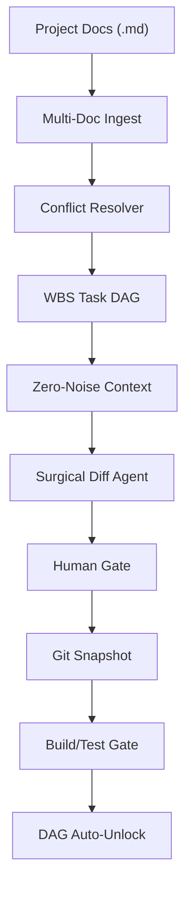

# 🏛️ UniGov

> **Sovereign Autonomous Project Governance Engine & Deterministic State Machine for AI-Native & Multi-Repo Software Ecosystems.**  
> *Stop AI Context Drift. Eliminate Hallucinated Completions. Enforce Architectural Ground Truth.*

[](https://www.python.org/)
[](LICENSE)
[]()
[]()
[]()

---

## ⚡ The Fundamental Problem with AI Coding

When building complex multi-repo systems, the primary failure mode is never generating syntax. The true bottlenecks are:

1. **Context Drift:** Beyond 40k–50k tokens, language models lose track of architectural constraints, room transaction boundaries, and previous design agreements.
2. **Hallucinated "Done":** AI coding agents regularly report tasks as complete without running compilers, linters, or test suites.
3. **Catastrophic File Overwrites:** Whole-file rewriting destroys working code, edge-case handlers, and existing comments.
4. **Multi-Repo Contract Desync:** Changing a database schema or API model in upstream Service A silently breaks downstream Service B.

**Antigravity PM (UniGov)** solves this by decoupling **Reasoning** from **State**:
- **Reasoning (AI):** LLMs (Gemini 2.5 Flash/Pro or Local Ollama models) are invoked strictly for document analysis and minimal search/replace diff generation.
- **Ground Truth (Spine):** An ACID-compliant local **SQLite WAL database (`.antigravity/state.db`) + Git commits** retain absolute truth. AI cannot alter state without human approval and deterministic compiler proof.

---

## 🏛️ System Pipeline



---

## 🚀 Key Architectural Capabilities

### 1. 📑 Multi-Doc Ingestion & Conflict Resolution
Ingests directories of documentation (specs, plans, architectural blueprints). Computes SHA-256 hashes to prevent redundant AI parsing, detects contradictions between documents, and asks the user for explicit arbitration before updating the database.

### 2. 🌲 Hierarchical Work Breakdown Structure (WBS)
Decomposes large milestones into a strict 3-tier hierarchy:
$$\text{Milestones} \longrightarrow \text{Modules} \longrightarrow \text{Atomic Tasks (15--30 mins, 1--3 files)}$$
Leaf tasks contain concrete `target_files` and a shell `verify_cmd`.

### 3. 🎯 Zero-Noise Context Bundler (`next`)
Picks the next unblocked `READY` task in topological DAG order and generates a clean, token-efficient prompt bundle:
- Project Vision & Locked Constraints
- Task Specification & Expected Acceptance Criteria
- Current Content of Target Files
- Shell Verification Command

### 4. 🔬 Surgical Search/Replace Diffs (`execute`)
Replaces whole-file rewriting with precise unified diff blocks:
```text
<<<<<<< SEARCH
def calculate_tax(amount):
    return amount * 0.18
=======
def calculate_tax(amount):
    return int(amount * 18 // 100)
>>>>>>> REPLACE
```
Features an automatic **line-by-line whitespace-tolerant fallback** that prevents patch rejections caused by subtle indentation or trailing space variations.

### 5. 🛡️ Automatic Git Checkpoints & 1-Second Rollback
Every execution creates a pre-execution Git tag (`ag-chk-<task_id>-<timestamp>`). If a patch introduces a regression or breaks compilation:
```bash
antigravity-pm rollback <task_id>
```
Instantly resets the repository to the pristine pre-task state.

### 6. 🧪 Zero-Trust Verification with Self-Healing Loop (`verify --auto-fix`)
- **Gate 1 (File Existence):** Confirms all `target_files` exist on disk.
- **Gate 2 (Build & Test Execution):** Executes `pytest`, `./gradlew test`, `npm test`, or cargo checks.
- **Self-Healing Loop:** If a test fails, error stack traces are fed back to the agent to propose corrective diffs (up to `--retries`).
- **Topological Cascade:** On verification, dependent downstream tasks automatically transition from `BLOCKED` to `READY`.

### 7. 🔒 Git Pre-Commit Hook & Architecture Drift Firewall
Installs a `.git/hooks/pre-commit` hook that intercepts commits:
- Blocks accidental commits of API keys or private certificates (`AIzaSy...`, `sk-proj-...`).
- Compares `git diff --cached` against the project's locked constraints and finalized ADRs.

### 8. 🌐 Cross-Project Ecosystem Contract Registry
Maintains a global registry at `~/.antigravity/ecosystem.db`.
- **Publish:** Upstream producer projects publish versioned contracts and schema files.
- **Subscribe:** Consumer projects subscribe to track upstream dependencies.
- **Acknowledge:** Alerts the developer when an upstream contract breaks, requiring explicit `contract-ack` after updating consumer code.

### 9. 📜 Architecture Decision Record (ADR) Ledger
Permanent record of all major design choices:
```bash
antigravity-pm adr ADR-001 "Inventory" "Use integer paise for currency" "Avoid float errors" --rejected "Double, Float"
antigravity-pm why "Inventory"
```

---

## 📦 Installation

### From Source (Recommended)
```bash
git clone https://github.com/UniAiOwner/antigravity-pm.git
cd antigravity-pm
pip install -e .
```

### With UV (Fastest)
```bash
uv pip install -e .
```

---

## 🛠️ CLI Command Reference

| Command | Description |
| :--- | :--- |
| `antigravity-pm init` | Initialize `.antigravity/state.db` SQLite state machine. |
| `antigravity-pm ingest <path>` | Ingest Markdown specs, resolve conflicts, and construct task DAG. |
| `antigravity-pm status` | View Vision Lock and hierarchical execution tree. |
| `antigravity-pm status --export`| Export live status dashboard to `PROJECT_STATUS.md`. |
| `antigravity-pm graph --mermaid`| Generate a color-coded Mermaid.js dependency diagram. |
| `antigravity-pm next` | Select next `READY` atomic task and export Zero-Noise context bundle. |
| `antigravity-pm execute <task_id>` | Run coding agent to propose surgical diffs with Human Approval Gate. |
| `antigravity-pm verify <task_id>` | Run Gate 1 (files) and Gate 2 (build/test) verification. |
| `antigravity-pm verify <task_id> --auto-fix` | Run verification with autonomous self-healing retry loop. |
| `antigravity-pm rollback <task_id>` | Revert workspace to Git checkpoint prior to task execution. |
| `antigravity-pm check-drift` | Audit staged git diff for secret leaks and constraint violations. |
| `antigravity-pm install-hook` | Install Git pre-commit hook for automated drift prevention. |
| `antigravity-pm audit` | Create SQLite backup, detect orphan code files, and check contracts. |
| `antigravity-pm costs` | Display cumulative token consumption and spend (USD & INR). |
| `antigravity-pm contract-publish` | Publish shared API/schema contract to global registry. |
| `antigravity-pm contract-subscribe` | Subscribe current project to an upstream contract. |
| `antigravity-pm contract-ack` | Acknowledge that local project code is synced with upstream changes. |
| `antigravity-pm adr` | Record an immutable Architecture Decision Record. |
| `antigravity-pm why <module>` | Query ADR Ledger to recall design decisions and trade-offs. |
| `antigravity-pm ui` (or `unigov ui`) | Launch full interactive Textual TUI dashboard for inspecting and navigating tasks. |

---

## ⚙️ Configuration & LLM Providers

Antigravity PM operates in **Offline / Local Mode** by default or connects to **Google Gemini** for high-IQ multi-document decomposition.

### Cloud Mode (Gemini 2.5 Flash / Pro)
```bash
export GEMINI_API_KEY="your-api-key"
export ANTIGRAVITY_PROVIDER="gemini"
```

### Offline / Local Mode (Ollama)
```bash
export ANTIGRAVITY_PROVIDER="ollama"
export OLLAMA_HOST="http://localhost:11434"
export OLLAMA_MODEL="qwen2.5-coder:14b"
```

---

## 🧪 Running Tests

```bash
pytest -v tests/
```

---

## 📄 License

Distributed under the **MIT License**. See [`LICENSE`](LICENSE) for details.

---

## 👨‍💻 Sovereign Authors & Credits

- **Founder & Chief Architect:** [Shoeb Ahmad](https://github.com/UniAiOwner)
- **Organization:** UniCore Technologies
- **Ecosystem:** UniAi, UniCortex, UniRetail
